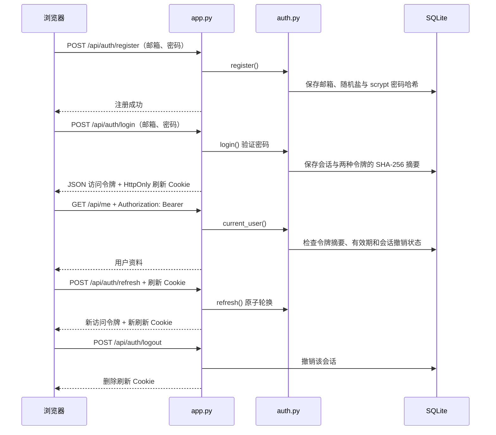

# No.1 · 注册与登录示例

一个可以在本机运行的中文登录页面，演示注册、密码验证、访问令牌、续期和退出登录。使用 Python 标准库和 SQLite，无需安装第三方包。

## 开始使用

需要 Python 3.10 或更高版本，且 Python 支持 OpenSSL 的 `hashlib.scrypt`。

1. 在 GitHub 的 **Code → Download ZIP** 下载仓库，解压。
2. 在解压后的文件夹打开终端。
3. 启动服务：

   ```bash
   python3 app.py
   ```

   Windows 可使用 `py app.py`。

4. 在浏览器打开 **http://127.0.0.1:8000**。不要直接双击 HTML 文件。
5. 先切换到「注册」，填写邮箱和 12–128 个字符的密码；注册后切换到「登录」。
6. 登录后尝试「查看个人资料」「续期登录」「退出登录」。退出后再次查看资料会要求登录。

终端按 Ctrl+C 停止。账号与会话保存在 `data/auth.sqlite3`，重启后仍可使用。删除 `data` 文件夹可以清空本机演示数据。这个目录已加入 `.gitignore`。

仓库保存代码；在 GitHub 打开仓库不会自动运行后端。本示例已经实现认证逻辑，尚未部署为公开网站。

## 文件与职责

| 文件 | 职责 |
| --- | --- |
| [app.py](app.py) | 本机 HTTP 服务、路由、请求来源检查、Cookie、限速和静态资源 |
| [auth.py](auth.py) | 密码哈希、用户数据、令牌签发与验证、续期轮换、会话撤销 |
| [static/index.html](static/index.html) | 中文注册、登录与个人资料页面 |
| [static/app.js](static/app.js) | 提交表单、内存中的访问令牌、自动续期与退出 |
| [static/style.css](static/style.css) | 自适应页面样式 |
| [tests/test_auth.py](tests/test_auth.py) | 密码、令牌生命周期、并发续期和 HTTP 流程测试 |
| [docs/authentication.md](docs/authentication.md) | 认证组件、请求流程、凭据与令牌的完整说明 |

## 认证如何工作



密码通过 **scrypt + 独立随机盐**保存。访问令牌是 256 位随机值，有效期最多 **15 分钟**，仅放在页面内存；刷新令牌也是 256 位随机值，放在 **HttpOnly、SameSite=Strict** Cookie 中，会话最多 **7 天**。数据库只保存令牌的 SHA-256 摘要；这是服务器查表验证的随机令牌方案，无需 JWT 签名密钥。

续期后，旧访问令牌立即失效，旧刷新令牌只能消费一次。重复使用旧刷新令牌会撤销整个会话。退出也会立即撤销该会话。详见 [认证说明](docs/authentication.md)。

## 接口

所有 POST 请求都要求同源 `Origin` 和 `Content-Type: application/json`，包括传空对象的续期与退出请求。

| 方法与地址 | 输入 | 返回 |
| --- | --- | --- |
| `POST /api/auth/register` | `{"email":"you@example.com","password":"example-password-2026"}` | `201` 用户公开资料，不自动登录 |
| `POST /api/auth/login` | 邮箱、密码 | `200` 访问令牌、有效期、用户资料；Cookie 保存刷新令牌 |
| `GET /api/me` | `Authorization: Bearer <access_token>` | `200` 用户资料，未认证返回 `401` |
| `POST /api/auth/refresh` | `{}`，浏览器自动发送刷新 Cookie | 新令牌对；无效会话返回 `401` |
| `POST /api/auth/logout` | `{}`，浏览器自动发送刷新 Cookie | 撤销当前会话并清除 Cookie |

错误使用 `{"error":"中文错误说明"}`。邮箱重复返回 `409`；每个客户端地址每 60 秒最多 20 次注册、登录、续期请求，超限返回 `429`；退出不受该限速限制。

## 测试

```bash
python3 -m unittest discover -s tests -v
```

测试使用临时数据库，不修改演示账号。覆盖密码加盐、无效输入、错误密码、数据库令牌摘要、访问过期、续期轮换、旧令牌重放、并发续期、会话绝对过期、退出与独立会话、HTTP Cookie 和来源检查。

## 配置与适用范围

| 环境变量 | 默认值 | 用途 |
| --- | --- | --- |
| `PORT` | `8000` | 本机监听端口 |
| `AUTH_DB` | 项目下 `data/auth.sqlite3` | 数据库路径 |
| `APP_ORIGIN` | `http://127.0.0.1:<PORT>` | POST 来源与 Host 必须匹配的应用地址 |
| `COOKIE_SECURE` | 未开启 | 值为 `1` 时，刷新 Cookie 添加 `Secure`，用于 HTTPS 代理场景 |

服务固定绑定 `127.0.0.1`。默认本机 HTTP 场景不设置 `Secure`，这样浏览器能发送演示 Cookie。公开运行需 HTTPS，并启用 `COOKIE_SECURE=1`。Python `http.server` 用于学习与本机演示，正式服务应换为生产 Web 服务并补充账号找回、邮箱验证、持久化限速及会话清理。参见 [Python HTTP 服务文档](https://docs.python.org/3/library/http.server.html)。

此示例注册时直接接受邮箱标识，不验证邮箱所有权；不包含 OAuth、第三方登录、角色权限或找回密码。同一浏览器的多个标签页共享刷新 Cookie：页面内合并续期请求，多个标签页同时续期仍可能触发重放保护并要求重新登录。
